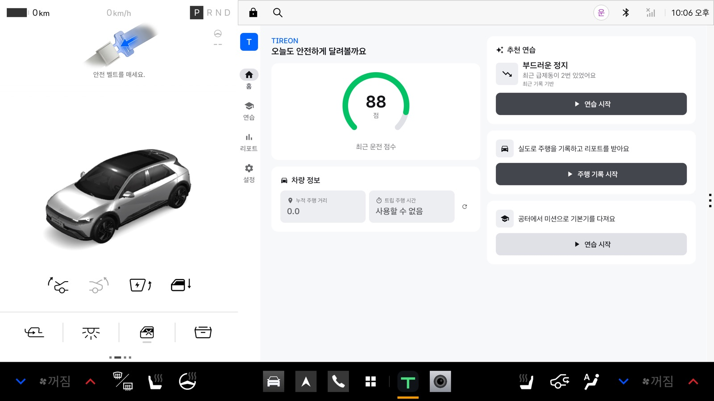
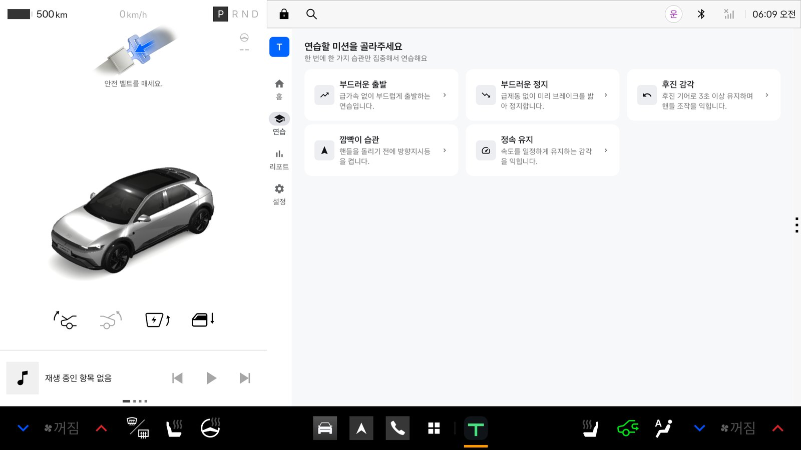
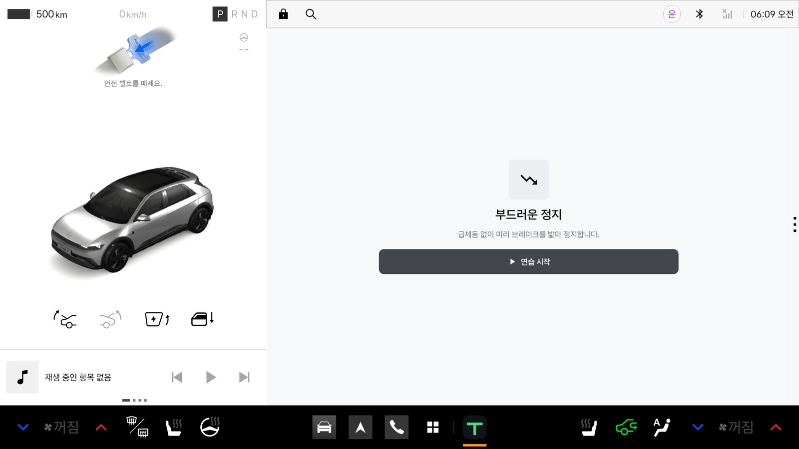
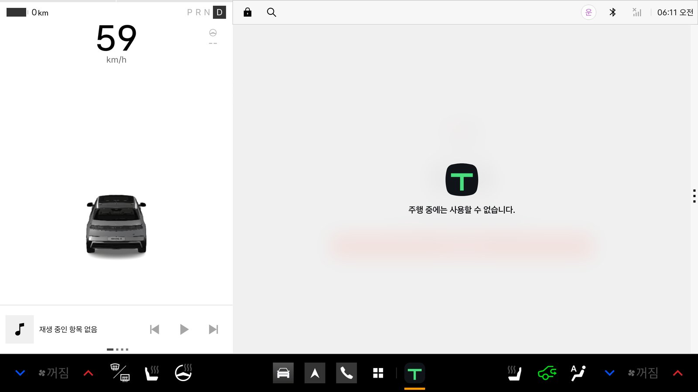
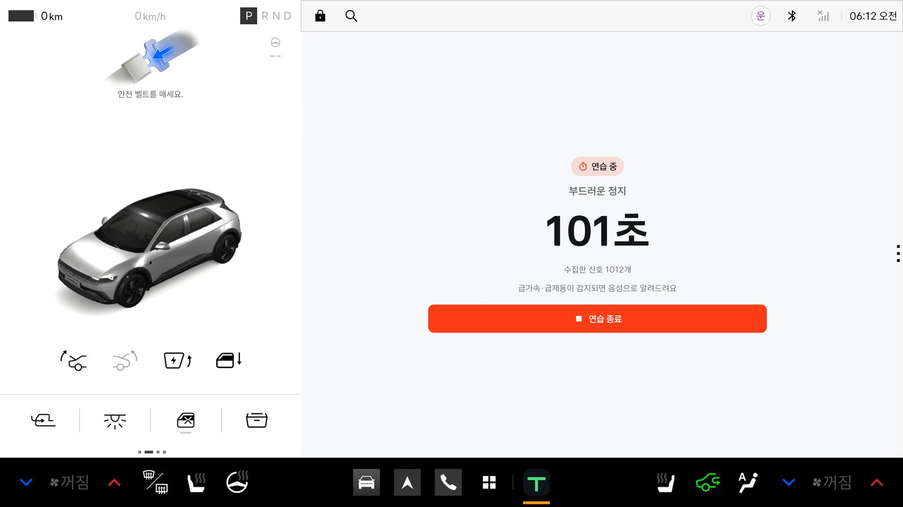
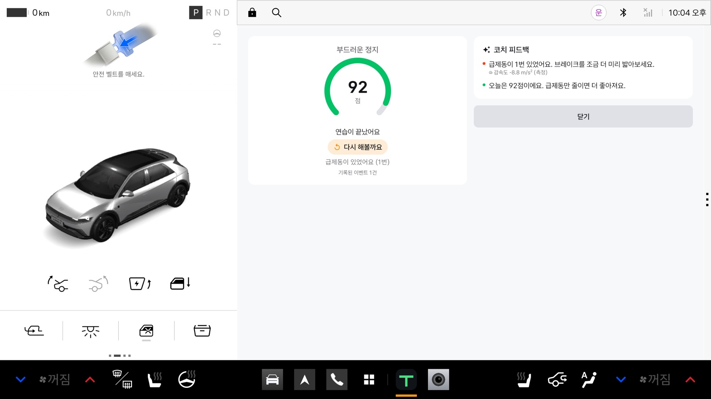
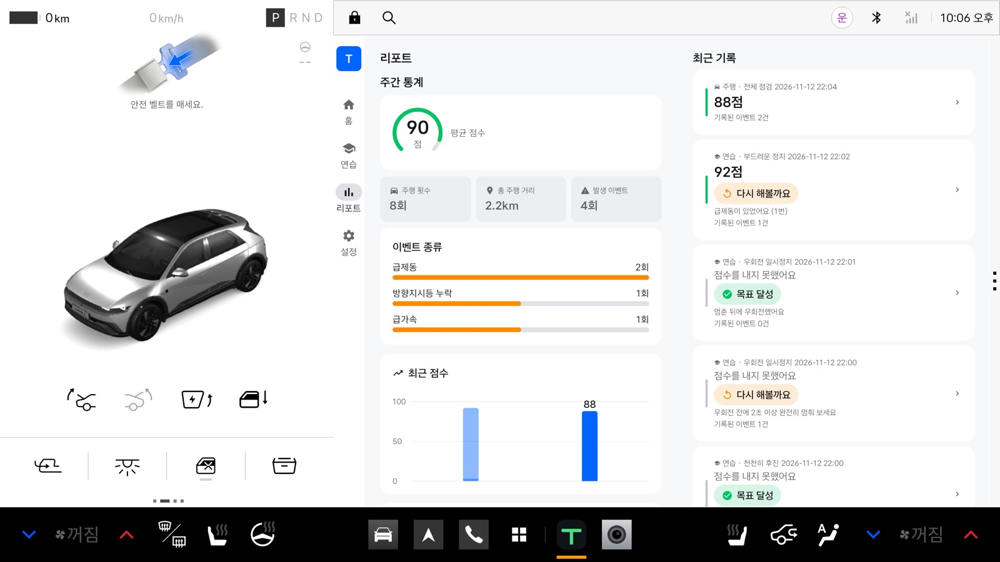
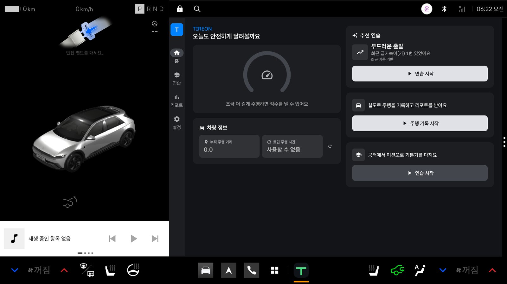
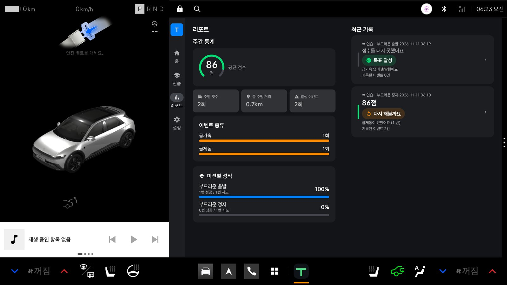
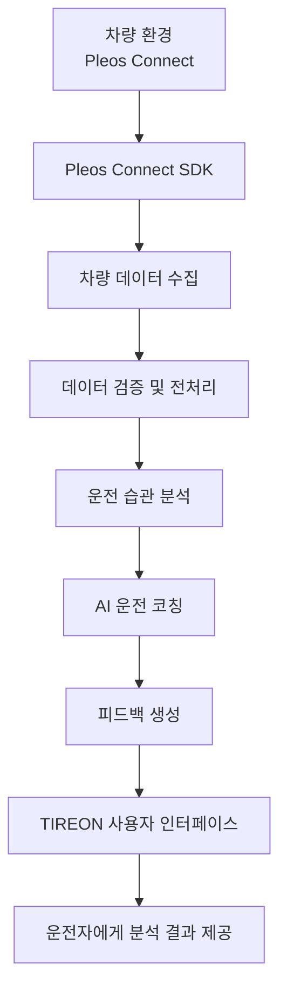

# TIREON

<p align="center">
  
  
  
  
  
</p>

<p align="center">
  <a href="https://github.com/TIREON1/TIREON/actions/workflows/ci.yml">
    
  </a>
</p>

<p align="center">
  <b>운전을 배우는 순간부터, 더 나은 운전 습관까지</b>
  <br />
  초보 운전자를 위한 AI 기반 운전 코칭 서비스 TIREON
</p>

---

## 1. 프로젝트 소개

<strong>TIREON(티레온)</strong>은 초보 운전자가 자신의 운전 습관을 이해하고 개선할 수 있도록 돕는 AI 기반 운전 코칭 서비스입니다.

운전자는 주행 중 다양한 도로 상황과 차량 정보를 마주하지만, 자신의 운전 습관이 안전한지 객관적으로 판단하기 어렵습니다. 특히 운전 경험이 부족한 초보 운전자는 주행 중 발생하는 상황에 적절하게 대응하는 데 어려움을 겪을 수 있습니다.

TIREON은 Pleos Connect 플랫폼과 차량 데이터를 활용하여 운전자의 주행 정보를 분석하고, 이를 바탕으로 개인화된 운전 피드백을 제공하는 것을 목표로 합니다.

단순히 차량 정보를 확인하는 것을 넘어, 운전자가 자신의 주행 패턴을 파악하고 안전한 운전 습관을 형성할 수 있도록 지원합니다.

### 프로젝트 목표

- **운전 습관 분석:** 차량 데이터를 기반으로 운전자의 주행 패턴을 파악합니다.
- **AI 운전 코칭:** 분석 결과를 바탕으로 운전자에게 적절한 피드백과 개선 방향을 제공합니다.
- **운전 경험 개선:** 초보 운전자가 자신의 운전 상태를 이해하고 점진적으로 운전 능력을 향상할 수 있도록 돕습니다.
- **차량 데이터 활용:** Pleos Connect SDK를 활용하여 차량에서 제공하는 데이터를 서비스에 연동합니다.

## 2. 기획 배경 및 문제 정의

### 2.1 기획 배경

운전을 처음 시작하는 사람들은 도로 환경에 익숙하지 않을 뿐만 아니라, 자신의 운전 습관을 객관적으로 평가하기 어렵습니다.

운전 중 급가속, 급제동, 불필요한 조작 등은 운전 습관을 판단할 수 있는 요소이지만, 운전자가 이러한 행동을 반복적으로 인식하고 개선하기는 쉽지 않습니다.

기존의 차량 정보 제공 서비스는 차량 상태나 주행 정보를 확인하는 데 집중하는 경우가 많습니다. 하지만 운전자가 자신의 행동을 이해하고 실제 운전 습관을 개선하도록 돕는 개인화된 코칭에는 별도의 접근이 필요합니다.

이에 TIREON은 차량 데이터를 단순히 보여주는 것이 아니라, 데이터를 해석하고 운전자에게 이해하기 쉬운 피드백으로 전달하는 서비스를 기획했습니다.

### 2.2 문제 정의

| 문제                    | 설명                                                                                  |
| ----------------------- | ------------------------------------------------------------------------------------- |
| 운전 습관 파악의 어려움 | 자신의 운전 방식이 안전한지 객관적으로 판단하기 어렵습니다.                           |
| 주행 데이터 활용 부족   | 차량에서 수집할 수 있는 정보가 실제 운전 습관 개선으로 이어지기 어렵습니다.           |
| 개인화된 피드백 부족    | 운전자의 주행 특성과 수준에 맞는 구체적인 개선 방향을 얻기 어렵습니다.                |
| 초보 운전자의 불안감    | 운전 경험이 부족하여 다양한 주행 상황에 대한 판단과 대응에 어려움을 겪을 수 있습니다. |

### 2.3 해결 방향

TIREON은 다음과 같은 방향으로 문제를 해결하고자 합니다.

1. 차량 데이터를 수집하여 운전자의 주행 정보를 파악합니다.
2. 수집된 데이터를 기반으로 운전 습관과 주행 패턴을 분석합니다.
3. 분석 결과를 AI가 이해하기 쉬운 피드백으로 제공합니다.
4. 운전자가 피드백을 바탕으로 자신의 운전 습관을 점진적으로 개선하도록 돕습니다.

## 3. 주요 기능

TIREON은 차량 데이터와 AI 분석을 결합하여 운전자에게 실질적인 도움을 제공하는 것을 목표로 합니다.

### 3.1 차량 데이터 연동

Pleos Connect SDK를 활용하여 차량에서 제공하는 데이터를 서비스에 연동합니다.

- 차량 데이터 수집 및 처리
- 주행 상태에 따른 데이터 확인
- 차량에서 지원하는 데이터 항목 확인
- 수집 데이터의 유효성 및 상태 검증

### 3.2 운전 습관 분석

수집된 차량 데이터를 기반으로 운전자의 주행 패턴을 분석합니다.

- 주행 중 발생하는 운전 행동 데이터 분석
- 급가속 및 급제동 등 운전 습관 관련 지표 분석
- 주행 데이터 기반 운전 패턴 파악
- 분석 결과를 통한 개선 요소 도출

※ 실제 분석 항목은 Pleos Connect SDK에서 제공하는 차량 데이터와 구현 가능 범위에 따라 결정합니다.

### 3.3 AI 운전 코칭

운전 습관 분석 결과를 AI가 해석하여 운전자에게 개인화된 피드백을 제공합니다.

- 운전 습관에 대한 이해하기 쉬운 설명
- 개선이 필요한 운전 행동 안내
- 운전자의 주행 특성에 맞는 개선 방향 제안
- 분석 결과에 기반한 맞춤형 코칭 제공

AI의 분석 결과는 참고용 운전 코칭 정보이며, 차량의 안전 시스템이나 운전자의 직접적인 판단을 대체하지 않습니다.

### 3.4 운전 정보 시각화

운전자가 자신의 주행 상태와 분석 결과를 쉽게 이해할 수 있도록 정보를 제공합니다.

- 주행 관련 데이터 표시
- 운전 습관 분석 결과 확인
- 주요 지표 및 피드백 제공
- 개선 사항 확인

※ 위 기능은 프로젝트의 기획 방향이며, 실제 구현 및 지원 여부는 개발 진행 상황에 따라 갱신합니다.

### 3.5 실행 화면

Pleos Connect v2.1.0 에뮬레이터(2560×1440)에서 촬영한 화면입니다.

| 홈 | 연습 미션 |
| --- | --- |
|  |  |
| **연습 준비** | **주행 중(시스템이 화면 차단)** |
|  |  |
| **정차 후 연습 종료 버튼** | **연습 결과와 코치 피드백** |
|  |  |
| **리포트** | **야간 모드 홈** |
|  |  |
| **야간 모드 리포트** | |
|  | |

## 4. 기술 스택

TIREON은 Pleos Connect 기반 차량용 애플리케이션 개발 환경을 중심으로 구성합니다.

| 구분            | 기술                         | 용도                          |
| --------------- | ---------------------------- | ----------------------------- |
| Platform        | Pleos Connect                | 차량용 앱 플랫폼              |
| OS              | Android Automotive OS (AAOS) | 차량용 애플리케이션 실행 환경 |
| Language        | Kotlin                       | 애플리케이션 개발             |
| JDK             | Java 21                      | 개발 및 빌드 실행 환경        |
| SDK             | Pleos Connect SDK            | 차량 기능 및 데이터 연동      |
| IDE             | Android Studio               | 개발 및 디버깅                |
| Build           | Gradle                       | 프로젝트 빌드 및 의존성 관리  |
| Version Control | Git / GitHub                 | 소스 코드 및 버전 관리        |
| CI              | GitHub Actions               | 자동 빌드 및 검증             |
| Test            | Pleos Connect Emulator       | 애플리케이션 테스트           |

## 5. 시스템 아키텍처

TIREON은 차량 데이터 수집부터 운전 습관 분석, AI 피드백 제공까지 이어지는 구조를 지향합니다.

### 5.1 전체 구조



### 5.2 주요 구성 요소

| 구성 요소         | 역할                                  |
| ----------------- | ------------------------------------- |
| Pleos Connect     | 차량용 앱 실행 및 차량 환경 제공      |
| Pleos Connect SDK | 차량 데이터 및 지원 기능 접근         |
| Data Processing   | 수집 데이터 검증 및 전처리            |
| Driving Analysis  | 운전 습관 및 주행 패턴 분석           |
| AI Coaching       | 분석 결과 해석 및 개선 방향 제안      |
| User Interface    | 운전자에게 차량 정보와 코칭 결과 제공 |

### 5.3 데이터 처리 흐름

1. **Data Collection:** Pleos Connect SDK를 통해 지원되는 차량 데이터를 수집합니다.
2. **Data Validation:** 수집된 데이터의 유효성과 상태를 확인합니다.
3. **Data Processing:** 분석에 필요한 형태로 데이터를 가공합니다.
4. **Driving Analysis:** 가공된 데이터를 기반으로 운전 습관을 분석합니다.
5. **AI Coaching:** 분석 결과를 바탕으로 운전자에게 적절한 피드백을 생성합니다.
6. **Result Display:** 생성된 피드백과 분석 결과를 애플리케이션에 표시합니다.

※ 위 아키텍처는 목표 구조를 나타냅니다. 실제 API 구성과 데이터 처리 방식은 구현 과정에서 확정합니다.

## 6. 팀원 및 역할

TIREON은 총 3명의 팀원이 함께 개발하는 프로젝트입니다.

| 이름   | 담당 역할 |
| ------ | --------- |
| 박다윗 | 추후 기재 |
| 이채린 | 추후 기재 |
| 전정완 | 추후 기재 |

각 팀원은 담당 기능 개발뿐 아니라 코드 리뷰와 프로젝트 품질 관리에도 참여합니다.

## 7. 실행 방법

### 제출 APK와 테스트 환경

| 항목 | 내용 |
| --- | --- |
| APK 위치 | [`apk/TIREON_TIREON_release.apk`](apk/TIREON_TIREON_release.apk) |
| 빌드 | release, 팀 서명 키로 서명 (APK Signature Scheme v2) |
| 빌드 소스 | [`57dea10`](https://github.com/TIREON1/TIREON/commit/57dea10c1214d38861299601d80c9c391c1a3241), 연습 시작·미션 결과 음성 안내 포함 |
| 빌드 실행 | [Release #43388357212](https://github.com/TIREON1/TIREON/actions/runs/43388357212) |
| APK SHA-256 | `f08e82aa7955aaec0dd03d436d93f40bf31b47949f8fce68f821423fe3fc74f4` |
| 버전 | 0.1.0 (versionCode 1), 패키지 `ai.tireon.app` |
| 개발·테스트 에뮬레이터 | Pleos Connect Emulator v2.1.0 (Android 14, arm64) |
| 화면 규격 | 2560×1440, 160dpi |

에뮬레이터가 실행 중일 때 다음 명령으로 설치합니다.

```bash
adb install -r apk/TIREON_TIREON_release.apk
```

디버그 빌드가 설치되어 있으면 서명이 달라 설치가 거부됩니다. `adb uninstall ai.tireon.app`으로 먼저 지웁니다.

차량 신호(기어, 속도, 조향, 방향지시등)는 에뮬레이터의 Virtual Console에서 바꿀 수 있습니다. 앱은 차량이 정지했을 때만 조작 화면을 보여 주고, 주행 중에는 시스템이 화면을 가립니다.

### 7.1 개발 환경 준비

프로젝트 실행을 위해 다음 환경이 필요합니다.

- Android Studio
- JDK 21
- Kotlin
- Gradle
- Pleos Connect SDK
- Pleos Connect Emulator

### 7.2 프로젝트 가져오기

저장소를 로컬 환경에 복제합니다.

```bash
git clone https://github.com/TIREON1/TIREON.git

cd TIREON
```

Android Studio에서 프로젝트 폴더를 열고 Gradle 동기화를 진행합니다.

Android SDK 경로는 Android Studio가 자동으로 `local.properties`에 기록합니다. 이 파일은 커밋하지 않습니다.

### 7.3 SDK 및 개발 환경 설정

1. Android Studio에서 프로젝트를 엽니다.
2. JDK 21을 설정합니다.
3. 필요한 Pleos Connect SDK 및 개발 환경을 설정합니다.
4. Gradle Sync를 실행하여 의존성을 동기화합니다.
5. 필요한 경우 프로젝트에서 요구하는 로컬 설정을 진행합니다.

Pleos Connect SDK 아티팩트는 `ai.pleos.playground` 그룹으로 Pleos Nexus에서 받아옵니다. SDK를 사용하는 코드는 `:pleos` 모듈에만 두어 다른 모듈로 SDK 타입이 노출되지 않게 합니다.

차량 데이터 조회는 다음 순서를 따릅니다.

1. `Vehicle(context)` 생성 후 `initialize()`
2. `getXxx()`로 도메인 객체 획득
3. `checkXxxCapabilities`로 지원 여부 확인
4. 지원되는 경우에만 값을 조회
5. 화면 종료 시 `release()`

`Odometer` 조회에는 `pleos.car.permission.CAR_DRIVE` 권한이 필요하며, `:pleos` 모듈의 Manifest에 선언되어 있습니다. 이 권한은 런타임 승인 창이 아니라 Manifest 선언으로 부여됩니다.

### 7.4 애플리케이션 실행

1. Pleos Connect Emulator를 실행합니다.
2. Android Studio에서 프로젝트 실행 구성을 선택합니다.
3. 대상 에뮬레이터를 선택합니다.
4. Run을 실행하여 애플리케이션을 설치하고 실행합니다.

에뮬레이터는 GPU 가속을 켜고 실행합니다.

```bash
~/Library/Android/sdk/emulator/emulator -avd Pleos_Connect_v2.1 \
  -no-snapshot-load -no-boot-anim -gpu host
```

`-gpu swiftshader_indirect`(소프트웨어 렌더링)를 쓰면 차량 화면의 3D 렌더링이
CPU로 돌아 에뮬레이터가 느려집니다. 계측 테스트도 실패합니다. `-gpu host`를
사용하면 Metal 가속이 적용되어 쾌적하게 동작합니다.

### 7.4.1 계측 테스트

계측 테스트는 Pleos 에뮬레이터에서만 실행됩니다. Pleos 시스템 이미지는 arm64
전용이고 공개 배포되지 않아 CI에서 실행할 수 없습니다. 로컬에서 실행합니다.

```bash
# 에뮬레이터가 실행 중이어야 합니다
./gradlew :app:connectedDebugAndroidTest
```

CI는 계측 테스트를 실행하지 않고 컴파일만 검증합니다.

### 7.5 빌드

Gradle Wrapper를 사용하여 빌드합니다. JDK 21이 필요합니다.

```bash
# 디버그 APK
./gradlew assembleDebug

# 단위 테스트 및 Lint
./gradlew test lint

# 릴리스 APK (서명 설정 필요)
./gradlew assembleRelease
```

서명된 릴리스 APK는 `app/build/outputs/apk/release/app-release.apk`에 생성됩니다.

`./gradlew build`는 release 패키징을 포함하므로 서명 설정이 필요합니다. 서명 없이 전체 검증을 하려면 `./gradlew assembleDebug test lint`를 사용합니다.

### 7.6 릴리스 서명

릴리스 빌드는 저장소 루트의 `keystore.properties`를 사용합니다.

```bash
cp keystore.properties.example keystore.properties
```

| 항목 | 설명 |
| --- | --- |
| `storeFile` | 키스토어 파일의 절대 경로 (저장소 밖에 보관) |
| `storePassword` | 키스토어 비밀번호 |
| `keyAlias` | 키 별칭 |
| `keyPassword` | 키 비밀번호 |

`keystore.properties`와 키스토어 파일은 커밋하지 않습니다. 파일이 없거나 값이 비어 있으면 릴리스 빌드는 `verifyReleaseSigning` 단계에서 실패합니다.

CI의 릴리스 워크플로는 GitHub Secrets로 `keystore.properties`를 생성하므로 별도 로컬 설정이 필요하지 않습니다.

## 8. CI (Continuous Integration)

TIREON은 GitHub Actions를 활용하여 코드 변경 사항을 자동으로 검증합니다.

Pull Request 및 `main` 브랜치 변경 시 문서 검사를 실행하고, Android Gradle 프로젝트가 구성되면 빌드·테스트·Lint까지 자동으로 검증합니다.

### 8.1 CI 환경

| 항목             | 설정                |
| ---------------- | ------------------- |
| CI Platform      | GitHub Actions      |
| Build System     | Gradle              |
| Language         | Kotlin              |
| JDK              | 21                  |
| Trigger          | Pull Request / Push / Manual |
| Build Validation | 문서 검사 + Gradle Build (조건부) |

### 8.2 자동 검증 항목

- 문서 링크, 후행 공백, YAML 구문 검사 (항상 실행)
- Issue/PR 템플릿 YAML 유효성 검사
- Gradle 의존성 및 프로젝트 설정 확인 (`gradlew` 존재 시)
- Kotlin 코드 컴파일 및 단위 테스트 (`gradlew` 존재 시)
- Android 디버그 빌드 및 Lint (`gradlew` 존재 시)

CI는 서명 키를 사용하지 않으므로 `assembleRelease` 대신 `assembleDebug`로 검증합니다.

### 8.3 CI 실행 조건

| 이벤트       | 실행 조건                               |
| ------------ | --------------------------------------- |
| Pull Request | `main` 브랜치 대상으로 생성 및 업데이트 |
| Push         | `main` 브랜치에 변경 사항 반영          |
| Manual       | GitHub Actions에서 수동 실행            |

### 8.4 CI 결과 확인

1. GitHub 저장소의 **Actions** 탭에 접속합니다.
2. 실행된 Workflow를 선택합니다.
3. 빌드 및 검증 결과를 확인합니다.
4. 실패한 경우 로그를 확인하고 오류를 수정합니다.

`main` 브랜치 병합에는 `Docs & templates` 상태 체크 통과가 필요합니다.

CI는 코드의 기본적인 빌드 안정성을 검증하는 과정이며, 실제 차량 환경에서의 동작이나 기능적 정확성까지 보장하지는 않습니다.

## 9. 개발 및 협업

TIREON은 GitHub를 통해 소스 코드와 작업 내용을 관리합니다.

### Branch Strategy

| 브랜치       | 용도                 |
| ------------ | -------------------- |
| `main`       | 안정적인 통합 브랜치 |
| `feature/*`  | 신규 기능 개발       |
| `fix/*`      | 버그 수정            |
| `refactor/*` | 코드 구조 개선       |
| `docs/*`     | 문서 수정            |
| `chore/*`    | 빌드·설정·유지보수   |

### Commit Convention

커밋 메시지는 다음 형식을 사용합니다.

```text
type: 작업 내용
```

예시:

```text
feat: AI 운전 코치 화면 구현
fix: 차량 데이터 수신 오류 수정
refactor: 운전 점수 계산 로직 개선
docs: README 작성
```

### Pull Request

- `main` 브랜치에 직접 Push하지 않습니다.
- 작업 브랜치에서 개발한 후 Pull Request를 생성합니다.
- PR 병합에는 다른 팀원 1명의 승인이 필요합니다.
- AI가 생성하거나 수정한 코드도 작성자가 직접 검토합니다.
- 승인 이후 `main` 브랜치에 병합합니다.

자세한 협업 규칙은 [CONTRIBUTING.md](CONTRIBUTING.md)를 참고하세요.

---

## 10. 프로젝트 정보

| 항목          | 내용                             |
| ------------- | -------------------------------- |
| 프로젝트명    | TIREON (티레온)                  |
| 프로젝트 유형 | 차량용 애플리케이션              |
| 개발 플랫폼   | Pleos Connect                    |
| 주요 대상     | 초보 운전자                      |
| 핵심 기술     | 차량 데이터 분석 및 AI 운전 코칭 |
| 개발 인원     | 3명                              |

---

<p align="center">
  <b>TIREON</b>
</p>
