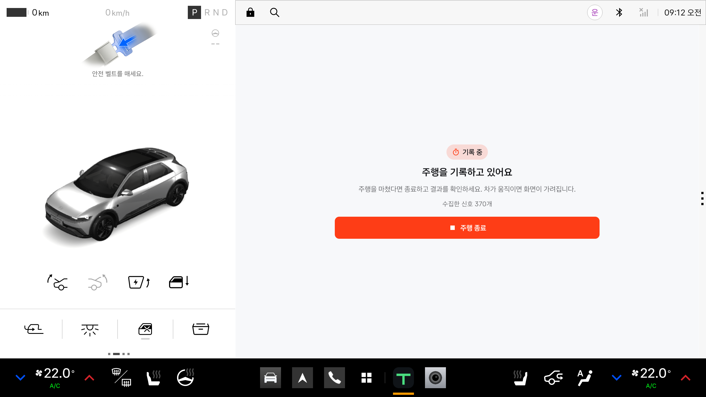
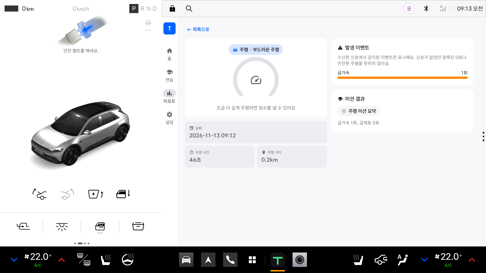
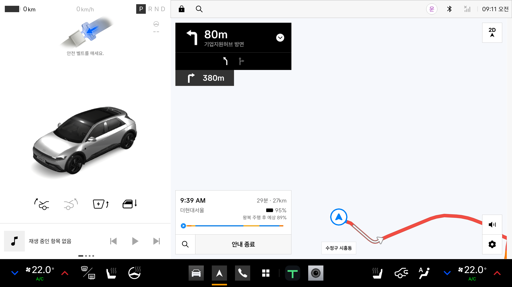
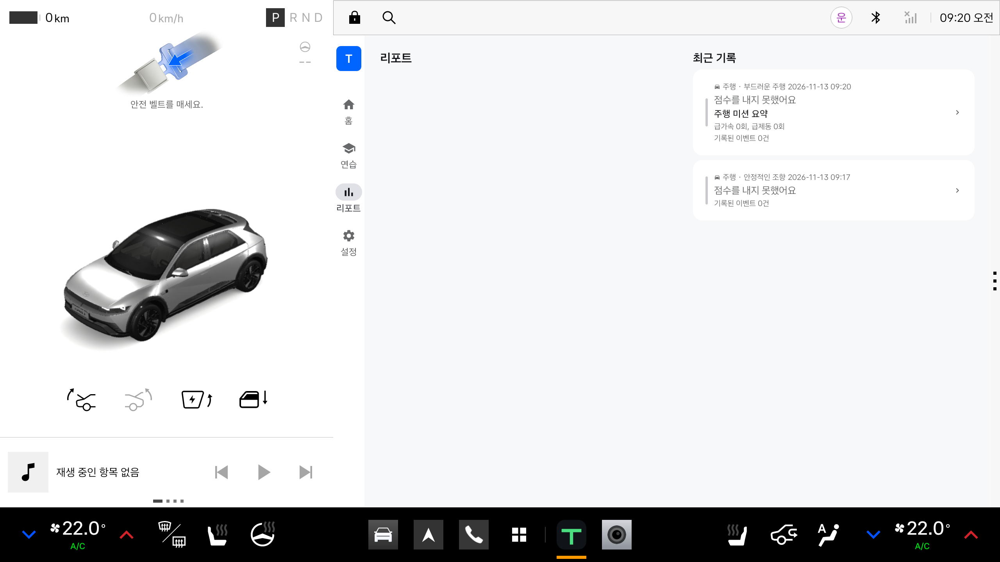

# 2026-11-14 최종 개발 검증

## 변경과 기준

- 1차 검증 기준 main: `b4aa62f`, 수정 소스: `ac534ee` (#57).
- #55: 주행 미션의 요약·판정 보류 사유를 저장하고 리포트 목록·상세에 표시한다.
- 저장 형식 v3의 `missionEvaluated`는 판정 완료/보류를 구분한다. 주행 미션의 `missionSuccess`는 계속 null이다.
- v1/v2 기록을 읽을 수 있고, 과거에 저장하지 않았던 미션 결과를 새로 만들어내지 않는다.
- 손상된 기록 파일을 읽지 못하면 새 저장을 실패시키고 원본을 보존한다.
- 내비 복귀 후 기록 중 뒤로가기로 액티비티가 종료되어 기록을 잃는 문제를 재현했다. 기록 중에는 태스크를 배경으로 보내 수집을 유지한다. 정차 후 종료 버튼으로 저장한다.
- 앱 버전: 1.1.1 / versionCode 3 (제출 APK 기준).

## 환경과 자동 검증

- macOS arm64, JDK 21, 프로젝트 Gradle Wrapper.
- Pleos Connect Emulator v2.1.0 / Android 14 API 34 / 2560×1440 / 160dpi / GPU host, Cold Boot.
- `assembleDebug test lint assembleDebugAndroidTest` 성공.
- 고유 JVM 테스트 406개: core 198, app 184, pleos 24. Android debug/release 중복 실행을 별개 테스트로 세지 않았다.
- Markdown·YAML 검사, 변경 공백 검사, 미해결 Git 충돌·충돌 표식 검사 통과.
- Lint 오류 0. 기존 경고는 app 28개, pleos 3개다. 버전 업데이트 안내, UI API 권장, 외부 SDK 네이티브 라이브러리의 16KB 정렬 경고 등이 남아 있다. 제출 직전 SDK/Gradle 일괄 업그레이드는 하지 않았다.
- 기능별 계측 74개는 통과를 확인했다(기존 70개 + 리포트 회귀 3개 + 실제 액티비티 뒤로가기 1개). 최종 전체 74개 연속 실행은 73개 통과 / 기존 통계 화면 1개 초기화 실패였다. 같은 통계 클래스 5개는 별도 실행에서 통과했다. 애니메이션을 끈 추가 전체 실행도 73개 통과 / 기존 홈 화면 1개 초기화 실패로, 애니메이션 설정만으로 해결되지 않았다. 시험한 애니메이션 설정은 원복했다.
- 계측 테스트에서 Pleos/ActivityScenario의 `No compose hierarchies` 및 `Current state was null unexpectedly` 초기화·정리 실패가 간헐적으로 발생했다. 전체 실행과 클래스별 재실행 결과를 구분해 기록한다. 제품 기능 실패가 없다는 근거로 이 실행 불안정성을 숨기지 않는다.

## 내비게이션 실측

| 시나리오 | 확인 결과 |
| --- | --- |
| 기록 시작 → 기본 내비 | `APP_MAPS`로 `ai.umos.maps.android.navigation.app` 실행 |
| 내비 표시 중 수집 | 포그라운드 서비스 `isForeground=true` 유지, 10초 이상 백그라운드에서도 수집 지속 |
| 주행 중 TIREON 복귀 | 40km/h에서 시스템의 주행 중 사용 불가 화면 표시 |
| 정차 후 복귀 | 수집 화면과 종료 버튼 다시 표시 |
| 기록 중 뒤로가기 → 복귀 | 수정 전 서비스 종료·기록 유실 재현. 수정 후 서비스 유지, 신호 245개 → 370개 증가 |
| 종료·저장 | 서비스 종료, 46초·0.226km 테스트 기록과 미션 요약 저장 확인 |
| 리포트 목록·상세 | `급가속 1회, 급제동 0회`와 `주행 미션 요약` 표시 |
| 리포트 상세 시스템 뒤로가기 | 홈이 아닌 리포트 목록으로 복귀 |
| 기본 내비 목적지 검색 | `Seoul` 검색 후 더현대서울 조회 성공 |
| 기본 내비 경로 조회·안내 | 경로 3개, 예상 29분·27km, 회전 안내와 경로선 표시 |
| 기본 내비 배경 지도 | 도로·건물 배경이 비어 보이는 현상 지속. TIREON 실행 여부와 별개로 내비 단독 실행에서도 관찰 |

위 내비 경로 수치와 위치는 에뮬레이터의 시험 데이터이며 실제 차량 주행 결과가 아니다. 이전 작업기록에 있던 `profile` unknown-key / Map42 초기화 오류는 이번 실행 로그에서 재확인되지 않았다. 현재 배경 지도 문제의 원인을 동일하다고 단정하지 않는다. 내장 시스템 앱이나 인증 응답을 수정하지 않았다.

## Release APK 검증

- GitHub Release workflow 실행: [43470216333](https://github.com/TIREON1/TIREON/actions/runs/43470216333), 빌드 소스 `ac534eef4bac8c1ff80dd0b5300a9ffc2c3faae8`.
- APK v2 서명 검증 통과. 인증서 SHA-256 `1f64520e18dfb6138ab3a92b5f1f9d95b11897262e296eff89ad2176855dbf9b`로 기존 제출본과 동일한 팀 키다.
- 패키지 `ai.tireon.app`, 1.1.1 / versionCode 3, debuggable 아님.
- APK SHA-256: `7414dd81571e9f3cd814712eaf3ad94030ecfec3d2f97cb0c7fb04a8eee189e5`.
- `-read-only` Pleos 에뮬레이터에서 기존 1.1.0 release 설치 → 안정적인 조향 기록 생성 → 새 release를 `adb install -r`로 업데이트 → 같은 날짜·미션 기록과 상세를 읽는 것까지 확인했다.
- 새 release에서 알림 권한 거부 → 내비 전환 → 12초 이상 대기 → 복귀 → 뒤로가기 → 재복귀 → 종료를 실행했다. 포그라운드 서비스 유지, 종료 후 서비스 정리, 새 미션 요약 저장과 기존 기록 공존을 확인했다. 재부팅 후 해당 시험 구간에 TIREON 크래시 로그는 없었다.
- 내비 미설치 조건은 시스템 내비를 임시 비활성화하자 Pleos 런처가 재시작되어 앱 시나리오를 검증하지 못했다. 즉시 기본 상태로 복구했다. 코드의 `ActivityNotFoundException` 처리 확인과 실제 미설치 환경 검증을 구분한다. 이 시험은 임시 복사본에서만 실행했다.

## 실행 화면

수정 소스의 debug 앱과 동일 Pleos 환경에서 촬영했다.

기존 release 기록과 새 release 기록이 함께 표시된다.

## 범위와 남은 사항

- 실제 차량, 장시간 운전, OS 강제 종료 후 미저장 세션 복구는 검증·보장 범위가 아니다. 현재 기록은 프로세스가 살아 있는 동안 유지된다.
- #56 설계 문서의 액티비티·기어 소스·LLM 미구현 상태·중복 설명을 정리했다.
- Release 워크플로 산출물명은 #59에서 `apk/TIREON_TIREON_release.apk`로 통일했다. 제출 파일도 같은 이름으로 보관한다.
- 최종 병합은 팀 리뷰 후 결정한다. 기존 이슈의 제출 기준 커밋 보존 방침에 따라 자동 병합하지 않는다.

## 리뷰 후속 수정 (2026-11-14, main `92d1028` 기준)

#57·#59 병합 후 리뷰에서 확인한 판정 오판 3건과 안전 항목 3건을 수정했다. 아래는 이 수정의 검증 기록이다.

### 수정 내용

- **깜빡이 습관**: 속도 신호가 없으면 회전 여부를 확인할 수 없다. 기존에는 `isRoadDriving`이 false가 되어 "회전하지 않았다"로 실패 판정했다. 이제 `EventDetector`가 도로 주행 여부를 3상태(YES/NO/UNKNOWN)로 구분하고, 판정 불가로 돌려준다. `MissionCatalog`의 `requiresSpeed`도 true로 맞췄다.
- **천천히 후진**: 기어 콜백 공백 500ms 이내는 같은 후진 구간으로 이어 본다. 2초 이상 끊기면 분리한다.
- **우회전 일시정지**: 후진 기어이거나 차속이 음수인 구간은 우회전 성공으로 보지 않는다.
- **`SettingsViewModel`**: `requestId` 선언을 `init`보다 앞으로 옮기고, 콜백 스레드에서 읽는 값을 락으로 보호한다.
- **저장 경로**: `runCatching`이 코루틴 취소를 저장 실패로 바꾸지 않도록 `CancellationException`을 재던진다.

### 자동 검증

- 고유 JVM 테스트 629개 통과: core 205, app 376(debug/release 중복 포함), pleos 48. 실패 0.
- 신규 재현 테스트 `MissionEvaluatorFalseVerdictTest` 7개는 수정 전 코드에서 5개 실패, 수정 후 전부 통과했다.
- `clean test assembleDebug lint assembleDebugAndroidTest` 성공. Lint 오류 0, 신규 경고 없음(28/3 유지).
- 계측 테스트 76개 중 75개 통과. `OnboardingScreenTest` 1개가 기존에 알려진 `No compose hierarchies`로 초기화 실패했고, 같은 클래스 별도 실행에서 통과했다. 이 테스트는 이번 수정에서 변경하지 않았다.

### Pleos 에뮬레이터 실제 신호 검증

`PleosSignalVerdictTest`를 추가해 Virtual Console 신호 주입이 실제 VHAL/DDS 경로를 거쳐 앱 수집 계층과 판정기에 도달하는지 확인했다.

| 항목 | 확인 결과 |
| --- | --- |
| 조향 부호 정규화 | 주입 120° → 수집 `+120.0` (좌회전 양수 규약) |
| 속도 수집 | 20km/h 주입 → 3.33~5.56 m/s 수집 |
| 방향지시등 수집 | `OFF` → `LEFT` 전환 확인 |
| 깜빡이 켜고 회전 | `Success("방향지시등을 잘 켰어요")` |
| 깜빡이 없이 회전 | `Failed("방향지시등 없이 조향한 구간이 있었어요 (1번)")` |

- 이 테스트는 신호 API가 없으면 skip한다. 실행 전 Virtual Console을 브라우저로 한 번 열어 `emulator_active`를 켜야 한다.
- 콘솔은 게스트 내부 `127.0.0.1:8088`에 있고, 앱도 같은 게스트에서 실행되므로 loopback으로 접근한다.
- 속도 수집에는 `CAR_SPEED` 런타임 권한이 필요해 테스트에 `GrantPermissionRule`을 두었다.

### 이번 수정의 남은 한계

- 새 APK를 빌드하지 않았다. 판정 동작이 바뀌었으므로 제출 APK를 갱신하려면 `Release` 워크플로를 다시 실행하고 README의 해시를 갱신해야 한다.
- 실차 신호(특히 조향 부호, 후진 시 속도 부호)는 여전히 검증 범위 밖이다.
- 우회전 판정은 조향 방향(좌/우)을 부호로 구분하지 않는다. 어느 쪽이 양수인지 실차에서 확인하지 못해 방향은 방향지시등으로만 판단한다.

## 공식 가이드

- [공모전 개발 환경](https://appdevchallenge.auto-hmg.io/guide/development)
- [제출 방법과 APK·README 요구사항](https://appdevchallenge.auto-hmg.io/guide/submission)
